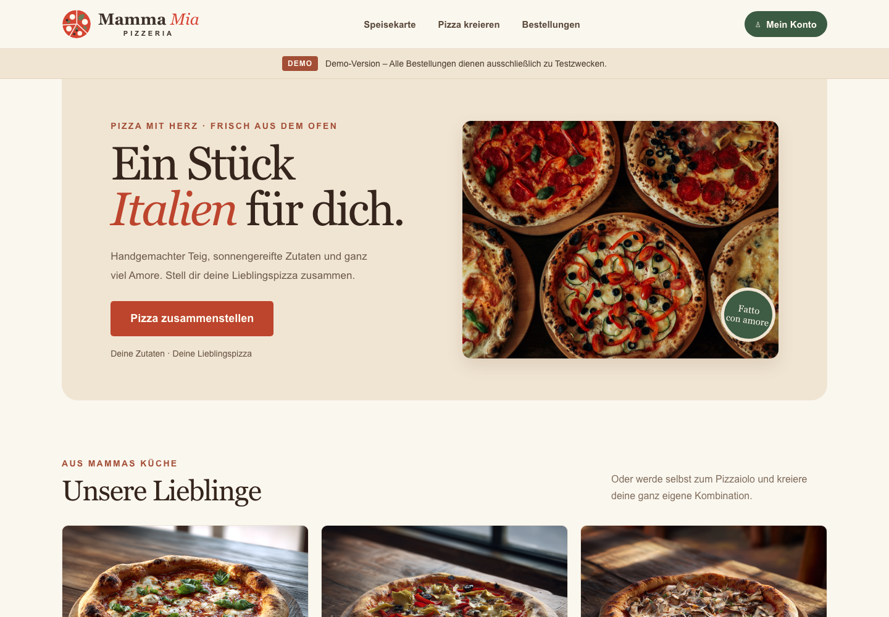
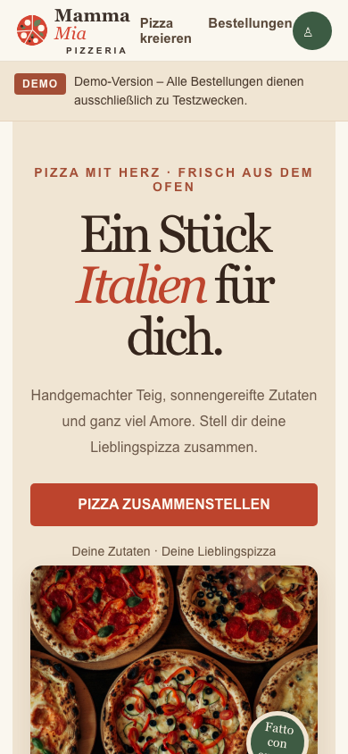

# Mamma Mia — Pizza mit Amore

Interaktiver Pizza-Konfigurator mit React und TypeScript. Wähle Teig, Größe und Belag, verfolge den Preis und probiere eine lokale Demo-Bestellung aus.

**[Live-Demo ansehen](https://annafillanna.github.io/Pizzeria-Mama-Mia/)**

<p align="center">
  
  &nbsp;
  
</p>

## Funktionen

- Drei Teigarten, drei Größen und 45 auswählbare Zutaten
- Menü-Pizzen als anpassbare Vorauswahl
- Sofortige Preisberechnung mit nachvollziehbarer Aufschlüsselung
- Lokale Bestellhistorie, Profilansichten und separater Demo-Gastmodus
- Responsive Oberfläche für Desktop und Smartphone

## Technische Entscheidungen

- **Redux-Zustand:** Gespeichert werden Größe, Teig und Zutaten-IDs. Die Anzeige und der Preis werden daraus abgeleitet. → [pizzaSlice.ts](src/services/slices/pizzaSlice.ts)
- **Preise in Cent:** Eine gemeinsame Funktion berechnet alle Preise, zählt doppelte Zutaten nur einmal und prüft unbekannte IDs. Gespeicherte Bestellungen behalten ihre Preisaufstellung. → [pizza-pricing.ts](src/utils/pizza-pricing.ts)
- **Lokale Bestellungen:** Gastdaten liegen in `sessionStorage`, reguläre Demodaten in `localStorage`. Schlägt das Speichern fehl, bleibt die Auswahl für einen erneuten Versuch erhalten. → [local-demo-api.ts](src/utils/local-demo-api.ts)

## Tech Stack

React · TypeScript · Redux Toolkit · React Router · Vite · CSS Modules · Jest · Playwright

## Lokal starten

Node.js 22.12 oder neuer. Im Projektverzeichnis:

```bash
npm ci
npm run start
```

Lokale Adresse: [localhost:4000](http://localhost:4000/).

## Prüfungen

```bash
npx tsc --noEmit -p tsconfig.app.json
npm run check
npm test -- --runInBand
npm run build
npx playwright install chromium
npm run e2e
```

16 Unit-Tests und 9 Browser-Tests prüfen unter anderem Preise, Bestellungen, Gastmodus und Fehler beim Speichern. Playwright startet den lokalen Server automatisch.

## Demo-Hinweis

Es gibt kein Bestell- oder Authentifizierungsbackend, keine Zahlungen und keinen Versand. Profile werden nur simuliert; Passwörter werden weder geprüft noch gespeichert. Preise und Nährwerte sind Beispieldaten. Die Zutatenbilder wurden mit ImageGen erstellt.

Weitere Details: [Preisregeln](docs/pricing.md) · [Zutatenbilder](docs/ingredient-artwork.md)
