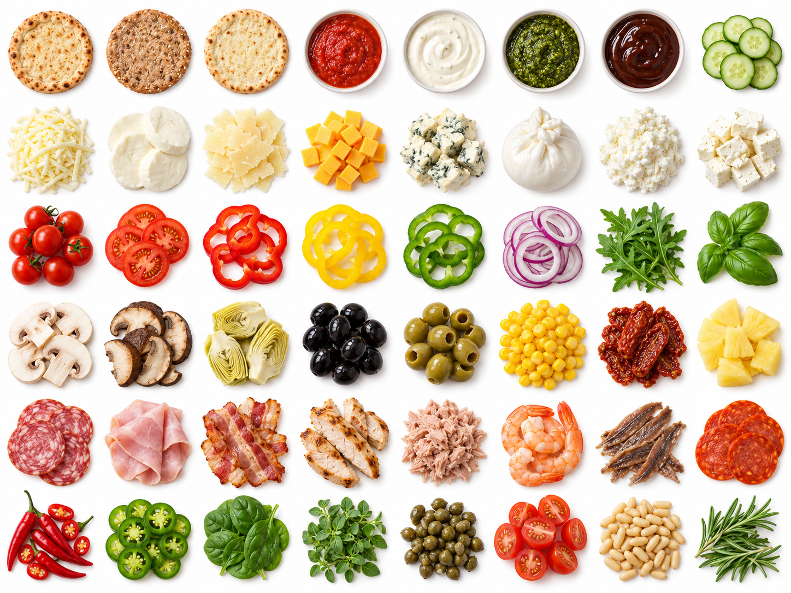

# Mamma Mia – Pizza mit Amore

Eine eigenständige Portfolio-Anwendung auf Basis von React, TypeScript, Redux Toolkit und React Router. Stelle Teig, Größe und Belag zusammen und lege eine lokale Bestellung an.

## Website

[🍕 Pizzeria Mamma Mia öffnen](https://annafillanna.github.io/Pizzeria-Mama-Mia/?v=0d54906)

Ohne Installation ausprobieren: Pizza zusammenstellen, Preis live sehen und eine Bestellung aufgeben. Die Anwendung ist ein Frontend-Portfolio-Projekt; alle Bestellungen bleiben im eigenen Browser.



## Start

```bash
npm ci
npm run start
```

Die Anwendung läuft unter `http://localhost:4000`.

## Funktionen

- Klassischer, Vollkorn- und glutenfreier Teig als separate Optionen
- 48 bebilderte Optionen: drei Teigböden, vier Saucen, Käse, Gemüse, Kräuter, Pilze, Fleisch und Meeresfrüchte
- Drei Größen und individuelle Kombinationen
- Redux-basierte Auswahl, Preisberechnung und lokale Bestellbestätigung
- Lokale Bestellhistorie und Profilansichten im Browser
- Keine Verbindung zur Stellar-Burgers-API oder zu einem Bestellserver

Bestellungen und das Profil werden lokal im Browser gespeichert. Es wird keine echte Bestellung übermittelt. Passwortfelder dienen nur der Veranschaulichung und Passwörter werden nicht gespeichert. Für echte Konten, Zahlungen oder Bestellungen wäre ein eigener sicherer Backend-Service erforderlich.

## Prüfungen

```bash
npx tsc --noEmit -p tsconfig.app.json
npm run check
npm test -- --runInBand
npm run build
npm run e2e
```

Playwright startet den Vite-Server für E2E-Tests automatisch. Falls der Chromium-Testbrowser noch fehlt, lässt er sich einmalig mit `npx playwright install chromium` installieren.

## Veröffentlichung

`npm run deploy` baut die Anwendung und veröffentlicht `dist/` auf dem Branch `gh-pages`. In GitHub → Settings → Pages muss „Deploy from a branch“, `gh-pages` und `/ (root)` ausgewählt sein. Hash-Routing unterstützt direkte Links zu Unterseiten ohne Serverkonfiguration.

Die Zutatenbilder wurden mit dem integrierten ImageGen-Werkzeug erstellt. Das Atlas-Original liegt unter `public/ingredients/atlas.png`; die einzelnen Kacheln werden als lokale JPG-Dateien geladen. Preise und Nährwerte sind illustrative Beispieldaten.
