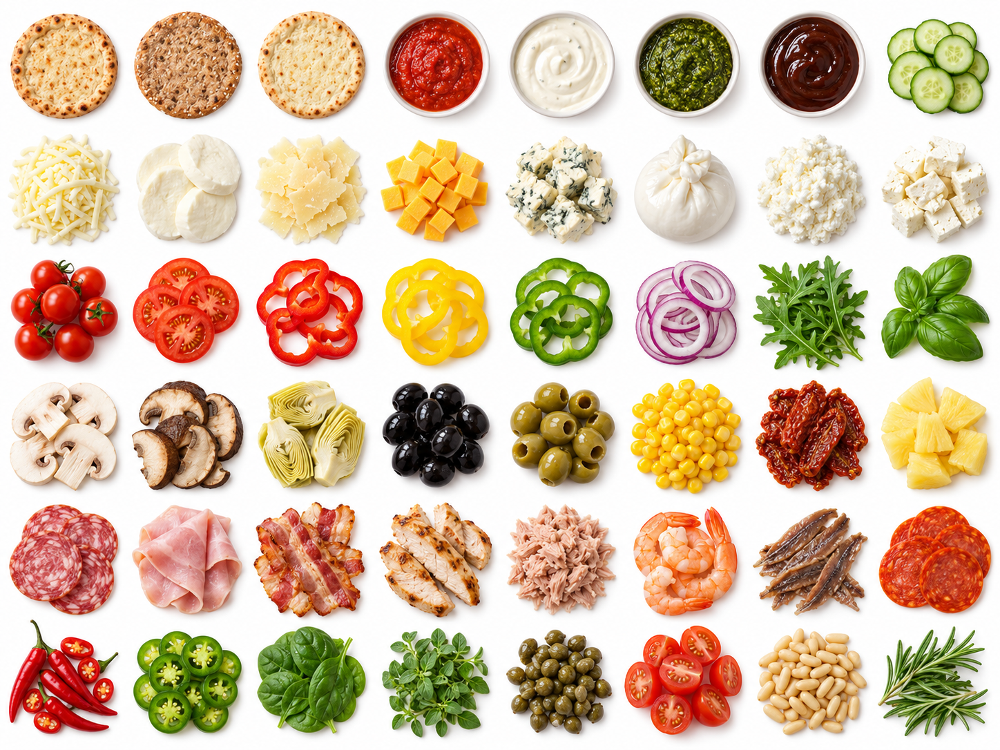

# Mamma Mia – Pizza mit Amore

Eine eigenständige Portfolio-Anwendung auf Basis von React, TypeScript, Redux Toolkit und React Router. Stelle Teig, Größe und Belag zusammen und lege eine lokale Bestellung an.

## Website

[🍕 Pizzeria Mamma Mia öffnen](https://annafillanna.github.io/Pizzeria-Mama-Mia/?v=0d54906)

Ohne Installation ausprobieren: Pizza zusammenstellen, Preis live sehen und eine Bestellung aufgeben. Die Anwendung ist ein Frontend-Portfolio-Projekt; alle Bestellungen bleiben im eigenen Browser.



## Technische Entscheidungen im Code

Der Konfigurator lässt sich anhand konkreter Dateien nachvollziehen:

| Aufgabe                | Umsetzung und Begründung                                                                                                                                                                     | Code                                                                                                                   |
| ---------------------- | -------------------------------------------------------------------------------------------------------------------------------------------------------------------------------------------- | ---------------------------------------------------------------------------------------------------------------------- |
| Auswahl verwalten      | Redux speichert Teig, Größe und Zutaten-IDs; Preise und angezeigte Zutaten werden daraus abgeleitet. Das vermeidet einen zweiten, unabhängig veränderbaren Preiszustand.                     | [pizzaSlice.ts](src/services/slices/pizzaSlice.ts), [ConstructorPage](src/pages/constructor-page/constructor-page.tsx) |
| Preise berechnen       | Eine gemeinsame Funktion rechnet in ganzen Cent, zählt doppelte Zutaten nur einmal und weist unbekannte IDs zurück. Rezeptkarten, Zusammenfassung und Bestellung nutzen dieselbe Preisregel. | [pizza-pricing.ts](src/utils/pizza-pricing.ts), [Preisregeln](docs/pricing.md)                                         |
| Bestellungen speichern | Beim Speichern wird der Preis erneut berechnet. Die Bestellung enthält ihre Preisaufstellung, damit spätere Katalogänderungen historische Beträge nicht verändern.                           | [local-demo-api.ts](src/utils/local-demo-api.ts)                                                                       |
| Gastmodus abgrenzen    | Gastbestellungen liegen in sessionStorage, reguläre lokale Demodaten in localStorage. Beim Wechsel der lokalen Identität wird zwischengespeicherter Redux-Zustand zurückgesetzt.             | [local-demo-api.ts](src/utils/local-demo-api.ts), [rootReducer.ts](src/services/rootReducer.ts)                        |
| Fehler behandeln       | Der Bestellablauf unterscheidet pending, fulfilled und rejected. Die Auswahl wird erst nach erfolgreichem Speichern geleert; bei einem Fehler kann sie erneut abgeschickt werden.            | [orderSlice.ts](src/services/slices/orderSlice.ts), [pizzaSlice.ts](src/services/slices/pizzaSlice.ts)                 |

### In wenigen Minuten ausprobieren

1. Im Konfigurator Größe und Teig wechseln und die Preisaufstellung beobachten.
2. Eine Menü-Pizza auswählen: Die Beläge wechseln, Größe und Teig bleiben erhalten.
3. Eine lokale Bestellung aufgeben, unter „Bestellungen“ öffnen und neu laden: Der gebuchte Preis bleibt erhalten.
4. Über „Als Demo-Gast testen“ eine getrennte Sitzung öffnen und nach dem Abmelden erneut starten: Die Gastbestellungen werden entfernt.

### Tests und Projektgrenzen

[Jest-Tests](src/utils/pizza-pricing.test.ts) prüfen unter anderem Größen- und Teigaufschläge, doppelte Zutaten, ungültige IDs und gespeicherte Preise. Die [Playwright-Szenarien](tests) prüfen den Bestellablauf, Preiswechsel, mobile Ansichten, Profile und die Trennung von Gastsitzungen.

Das Repository enthält auch ältere Komponenten mit Burger-Bezeichnungen sowie Storybook-Beispiele. Der aktive Pizza-Konfigurator liegt in [ConstructorPage](src/pages/constructor-page/constructor-page.tsx); die bestehenden Verzeichnisse sind erhalten geblieben. Bibliotheken übernehmen beispielsweise Rendering, Routing und Redux-Infrastruktur. Die projektspezifischen Regeln sind in den oben verlinkten Modulen nachvollziehbar. Die Herkunft der Zutatenbilder ist unten dokumentiert.

## Start

```bash
npm ci
npm run start
```

Die Anwendung läuft unter `http://localhost:4000`.

## Funktionen

- Klassischer, Vollkorn- und glutenfreier Teig als separate Optionen
- 48 bebilderte Optionen: drei Teigböden, vier Saucen, Käse, Gemüse, Kräuter, Pilze, Fleisch und Meeresfrüchte
- Drei Größen und individuelle Kombinationen
- Redux-basierte Auswahl, Preisberechnung und lokale Bestellbestätigung
- Lokale Bestellhistorie und Profilansichten im Browser
- Keine Verbindung zur Stellar-Burgers-API oder zu einem Bestellserver

Bestellungen und das Profil werden lokal im Browser gespeichert. Es wird keine echte Bestellung übermittelt. Passwortfelder dienen nur der Veranschaulichung und Passwörter werden nicht gespeichert. Für echte Konten, Zahlungen oder Bestellungen wäre ein eigener sicherer Backend-Service erforderlich.

## Prüfungen

```bash
npx tsc --noEmit -p tsconfig.app.json
npm run check
npm test -- --runInBand
npm run build
npm run e2e
```

Playwright startet den Vite-Server für E2E-Tests automatisch. Falls der Chromium-Testbrowser noch fehlt, lässt er sich einmalig mit `npx playwright install chromium` installieren.

## Veröffentlichung

`npm run deploy` baut die Anwendung und veröffentlicht `dist/` auf dem Branch `gh-pages`. In GitHub → Settings → Pages muss „Deploy from a branch“, `gh-pages` und `/ (root)` ausgewählt sein. Hash-Routing unterstützt direkte Links zu Unterseiten ohne Serverkonfiguration.

Die Zutatenbilder wurden mit dem integrierten ImageGen-Werkzeug erstellt. Das Atlas-Original liegt unter `public/ingredients/atlas.png`; die einzelnen Kacheln werden als lokale JPG-Dateien geladen. Preise und Nährwerte sind illustrative Beispieldaten.

### Demo-Gast im Portfolio

Auf `/login` startet „Als Demo-Gast testen“ eine lokale Gastsitzung ohne E-Mail
oder Passwort. Das Profil zeigt „Demo-Gast“; Änderungen sind sowohl in der UI
als auch in der lokalen API gesperrt. Gaststatus und Testbestellungen liegen in
`sessionStorage`, getrennt von den bisherigen lokalen Kontodaten. Neuladen
behält sie bei, Abmelden entfernt sie. Andere Besucher und unabhängig geöffnete
Tabs teilen keinen beschreibbaren Speicher. Beim Duplizieren eines Tabs kann der
Browser eine anfängliche Kopie übernehmen; danach bleiben beide Speicher getrennt.

Die bestehende Anwendung hat kein Authentifizierungs- oder Bestellbackend:
Registrierung/Login simulieren lokale Profile, ohne Passwörter zu prüfen oder zu
speichern. Diese Funktionen sind keine produktive Authentifizierung. Sämtliche
Bestellungen bleiben im Browser; es gibt weder Versand noch Zahlungsabwicklung.
Der Demo-Gast verwendet keine Zugangsdaten und keinen produktiven Account.
